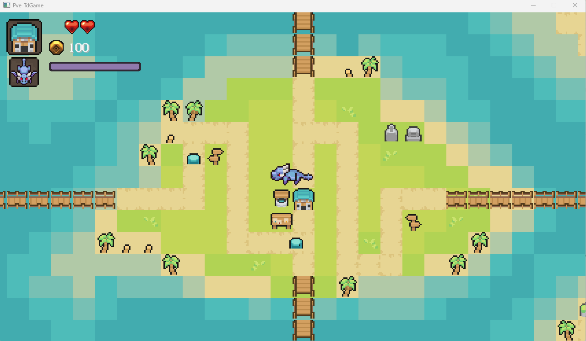
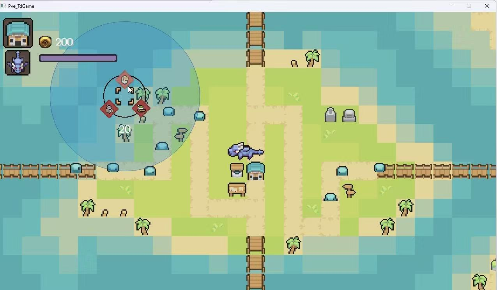

<div align="center">

# 2Player-TdGame

一款由键盘与鼠标玩家共同守卫基地的本地双人协作塔防游戏。

[](https://github.com/HHN224/2Player-TdGame/stargazers)
[](https://en.cppreference.com/w/cpp/20)
[](https://www.libsdl.org/)
[](https://www.microsoft.com/windows)

</div>

## 这是什么？

2Player-TdGame 是一款使用 C++20 与 SDL2 构建的 Windows 塔防游戏。鼠标玩家负责布置和升级防御塔，键盘玩家控制英雄移动并施放技能；两名玩家需要共享金币、抵御连续波次，并在基地生命耗尽前消灭所有敌人。

## 游戏画面

<div align="center">



<sub>完整地图、基地、英雄与状态栏</sub>

<br /><br />



<sub>迎击敌人时选择防御塔，并实时预览攻击范围</sub>

</div>

## 游戏特色

- 本地双人协作：键盘控制英雄，鼠标管理塔防
- 3 类防御塔：弓箭手、斧手与枪手
- 7 类敌人：史莱姆、疾行史莱姆、史莱姆王、骷髅、铁甲骷髅、哥布林与哥布林祭司
- 波次、金币、掉落、塔升级与基地生命系统
- 波次提示、空格暂停，以及 1/2/3 倍速
- 右键卖塔，并用金币修复基地生命
- 可通过 JSON 和 CSV 调整数值、波次与地图
- 基于 SDL2 的精灵动画、音效、背景音乐与 60 FPS 游戏循环

## 快速开始

### 直接运行

项目已包含 Windows x64 可执行文件和运行时依赖：

```powershell
git clone https://github.com/HHN224/2Player-TdGame.git
cd .\2Player-TdGame\TdGame
.\TdGame.exe
```

> [!IMPORTANT]
> 请从 `TdGame` 目录启动程序。游戏使用相对路径读取 `config.json`、`level.json`、`map.csv` 和 `resources/`。

### 从源码构建

准备以下环境：

- Windows 10 或 Windows 11
- Visual Studio，并安装“使用 C++ 的桌面开发”工作负载
- MSVC v145 工具集与 Windows 10 SDK

依赖头文件、库文件和 x64 DLL 已包含在 `thirdparty/` 中。使用 Visual Studio 打开 `TdGame/TdGame.vcxproj`，选择 `Release | x64` 后构建；也可以在 Developer PowerShell 中运行：

```powershell
msbuild .\TdGame\TdGame.vcxproj /p:Configuration=Release /p:Platform=x64
cd .\TdGame
.\x64\Release\TdGame.exe
```

如果本机没有 v145 工具集，请先在 Visual Studio 中将项目重定向到已安装的 MSVC 工具集。当前项目只有 `Release | x64` 配置完整声明了 SDL2 的包含目录和链接库。

## 操作方式

| 玩家 | 输入 | 操作 |
| --- | --- | --- |
| 英雄玩家 | <kbd>W</kbd> <kbd>A</kbd> <kbd>S</kbd> <kbd>D</kbd> | 移动英雄 |
| 英雄玩家 | <kbd>J</kbd> | 向当前朝向释放闪击 |
| 英雄玩家 | <kbd>K</kbd> | 消耗满额能量释放冲击并减速敌人 |
| 双方 | <kbd>Space</kbd> | 暂停或继续，暂停时仍可建塔 |
| 双方 | <kbd>1</kbd> <kbd>2</kbd> <kbd>3</kbd> | 将游戏速度调到 1 倍、2 倍或 3 倍 |
| 双方 | <kbd>R</kbd> | 花费 40 金币，为基地恢复 1 点生命 |
| 塔防玩家 | 鼠标左键点击空地 | 打开建塔面板 |
| 塔防玩家 | 鼠标右键点击防御塔 | 卖掉该塔，返还当前建造价的 60% |
| 塔防玩家 | 鼠标移动并点击面板选项 | 选择弓箭手、斧手或枪手 |
| 塔防玩家 | 鼠标左键点击基地 | 打开防御塔升级面板 |

击败敌人并拾取金币来建造或升级防御塔。橙色的疾行史莱姆血量更低，但会从两条路快速冲向基地。青灰色的铁甲骷髅会减免四成伤害，漏进基地时扣 2 点生命；第 4 波末尾先出现，第 6 波会和疾行史莱姆一起压上来。基地掉血后，状态栏会出现 `R40`，按 <kbd>R</kbd> 可以修复。守住全部波次即可获胜；基地生命耗尽则游戏结束。状态栏会显示当前波次，以及下一波倒计时或当前倍速。

## 配置

无需重新编译即可调整主要关卡内容：

| 文件 | 用途 |
| --- | --- |
| [`TdGame/config.json`](TdGame/config.json) | 窗口尺寸、英雄、塔与敌人的数值 |
| [`TdGame/level.json`](TdGame/level.json) | 波次间隔、奖励、生成点与敌人编排 |
| [`TdGame/map.csv`](TdGame/map.csv) | 地图地形、路线、出生点与基地布局 |

修改前建议保留一份原始文件，并确保 JSON 语法和地图标记仍符合加载器预期。

## 项目结构

```text
.
├── docs/
│   └── screenshots/        # README 使用的实机游戏截图
├── TdGame/
│   ├── resources/          # 精灵、界面、字体、音乐与音效
│   ├── x64/Release/        # 已有的 Release 构建产物
│   ├── config.json         # 游戏数值配置
│   ├── level.json          # 敌人波次配置
│   ├── main.cpp            # 程序入口
│   ├── map.csv             # 地图数据
│   └── TdGame.vcxproj      # Visual Studio C++ 项目
├── thirdparty/
│   ├── cJSON/
│   ├── SDL2/
│   ├── SDL2_gfx/
│   ├── SDL2_image/
│   ├── SDL2_mixer/
│   └── SDL2_ttf/
└── .gitattributes
```

## 技术栈

- C++20
- SDL2、SDL2_image、SDL2_mixer、SDL2_ttf、SDL2_gfx
- cJSON
- Visual Studio / MSVC

## 参与贡献

欢迎提交 Issue 或 Pull Request。建议在提交前：

1. 从 `main` 创建功能分支。
2. 使用 `Release | x64` 构建并运行游戏。
3. 确认资源、配置文件和 DLL 可从 `TdGame` 工作目录正常加载。
4. 在 Pull Request 中说明改动内容和验证方式。

<a href="https://github.com/HHN224/2Player-TdGame/graphs/contributors">
  
</a>

---

<div align="center">

[](https://star-history.com/#HHN224/2Player-TdGame&Date)

</div>
